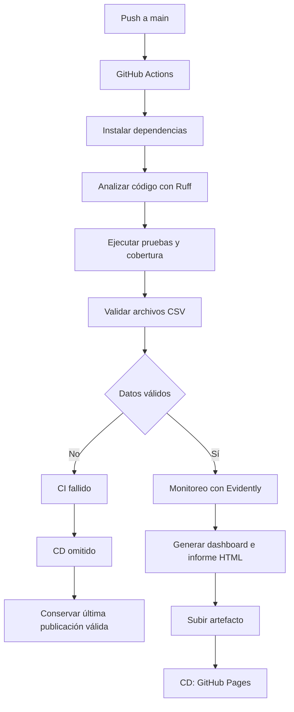

# Retail Sales Monitor

### Sistema de validación, monitoreo estadístico y CI/CD


## Descripción

Retail Sales Monitor es un sistema automatizado de validación,
monitoreo estadístico y publicación de informes de ventas.

El proyecto permite detectar errores de calidad en los datos,
identificar cambios en las distribuciones de cantidades y precios,
y publicar automáticamente los resultados mediante GitHub Pages.

Está orientado a responsables comerciales, analistas de datos
y gestores de inventario.

## Objetivo

Garantizar que únicamente los lotes de ventas válidos sean publicados,
manteniendo la trazabilidad de cada ejecución y conservando la última
publicación correcta ante posibles errores.

## Arquitectura



## Fuente de datos

Chen, D. (2015). Online Retail.
UCI Machine Learning Repository.

https://doi.org/10.24432/C5BW33

El archivo de trabajo contiene 36.000 líneas de factura,
distribuidas en tres muestras mensuales de 12.000 registros.

| Periodo | Archivo | Función | Registros |
|---|---|---|---:|
| Septiembre 2011 | referencia.csv | Referencia fija | 12000 |
| Octubre 2011 | control.csv | Lote de control | 12000 |
| Noviembre 2011 | nuevo.csv | Lote nuevo | 12000 |
| Variable | actual.csv | Lote que se publica | 12000 |

Cada fila representa una línea de factura.

Los resultados describen las muestras analizadas y no la
totalidad de las ventas mensuales.

## Estructura del proyecto

```text
retail-sales-monitor/
├── .github/
│   └── workflows/
│       └── ci-cd.yml
├── datos/
│   ├── original/
│   │   └── ventas_regalos_2011.csv
│   ├── referencia.csv
│   ├── control.csv
│   ├── nuevo.csv
│   └── actual.csv
├── scripts/
│   ├── __init__.py
│   ├── preparar_datos.py
│   ├── validar_datos.py
│   ├── generar_informe.py
│   └── generar_dashboard.py
├── templates/
│   └── index.html
├── tests/
│   └── test_validacion.py
├── .gitattributes
├── .gitignore
├── pyproject.toml
├── requirements.txt
└── README.md
```

## Instalación local

Se requiere Python 3.12 y Git.

En Windows, desde PowerShell:

```powershell
py -3.12 -m venv .venv
.\.venv\Scripts\Activate.ps1
python -m pip install -r requirements.txt
```

## Preparación de los datos

```powershell
python scripts/preparar_datos.py
```

El script separa los lotes, comprueba su cantidad de registros
y conserva el archivo original.

Si actual.csv ya existe, no se sobrescribe automáticamente.

## Validación

```powershell
python scripts/validar_datos.py
```

El sistema comprueba:

- Existencia y estructura de los archivos.
- Presencia de las siete columnas requeridas.
- Campos obligatorios no vacíos.
- Fechas y horas válidas.
- Cantidades enteras positivas.
- Precios positivos y finitos.
- Coherencia temporal de los lotes.
- Ausencia de mezcla de lotes.
- Integridad SHA-256 de la referencia.

Se permite la repetición del identificador de factura.

## Pruebas automatizadas

```powershell
python -m pytest tests/ -v
```

El proyecto dispone de 48 casos de prueba.

## Cobertura

```powershell
python -m pytest tests/ --cov=scripts.validar_datos --cov-report=term-missing --cov-report=html --cov-fail-under=90
```

Resultados locales iniciales:

- 48 pruebas exitosas.
- 99,15 % de cobertura del validador.
- Cobertura mínima requerida: 90 %.

## Calidad del código

```powershell
python -m ruff check scripts tests
```

## Generación del informe y dashboard

```powershell
python -m scripts.generar_informe
```

Archivos generados:

- site/index.html
- site/informe_evidently.html
- site/drift_resultados.json

Para visualizar el dashboard localmente:

```powershell
Start-Process .\site\index.html
```

## Monitoreo estadístico

| Parámetro | Configuración |
|---|---|
| Herramienta | Evidently 0.7.19 |
| Variables | Quantity y UnitPrice |
| Método | Wasserstein |
| Umbral | 0.1 |
| Referencia | Septiembre de 2011 |

Las comparaciones se realizan utilizando la misma configuración
y mantienen septiembre como referencia fija.

La detección de drift constituye una alerta informativa
y no bloquea el despliegue de un lote válido.

## Integración y despliegue continuo

El workflow se ejecuta automáticamente con cada push a main.

### Integración continua (CI)

1. Recupera el código del commit.
2. Instala las dependencias.
3. Comprueba la calidad del código.
4. Ejecuta las pruebas y controla la cobertura.
5. Valida los archivos CSV.
6. Genera los informes.
7. Sube el artefacto de publicación.

### Despliegue continuo (CD)

CD depende del éxito de CI.

Si alguna comprobación obligatoria falla, el despliegue
queda omitido y GitHub Pages conserva la última versión válida.

## Escenarios de demostración

| Escenario | Resultado esperado |
|---|---|
| Primera publicación: octubre | CI y CD exitosos |
| Actualización válida: noviembre | CI y CD exitosos |
| Fecha imposible | CI fallido y CD omitido |
| Recuperación del dato | CI y CD exitosos |

## Actualización mensual

Para utilizar el lote de noviembre:

```powershell
Copy-Item .\datos\nuevo.csv .\datos\actual.csv -Force
```

Después se realiza un commit y push a main.

El archivo referencia.csv no debe modificarse.

## Recuperación

Ante un error de validación:

1. Consultar los registros de GitHub Actions.
2. Identificar el archivo, fila y campo afectados.
3. Restaurar el valor original.
4. Validar nuevamente los archivos.
5. Realizar un nuevo commit y push.
6. Comprobar la publicación correcta en GitHub Pages.

## Seguridad y trazabilidad

- Exclusión de credenciales mediante .gitignore.
- Exclusión de entornos virtuales y archivos temporales.
- Verificación SHA-256 del lote de referencia.
- Identificación del commit publicado.
- Enlace a la ejecución de GitHub Actions.
- Fecha de generación en UTC.
- Permisos limitados para los trabajos de CI/CD.

## Autor

TU NOMBRE COMPLETO

Universidad Privada del Valle — UNIVALLE

Ingeniería en Ciencia de Datos e Inteligencia de Negocios

Unidad de Aprendizaje 5 — 2026
